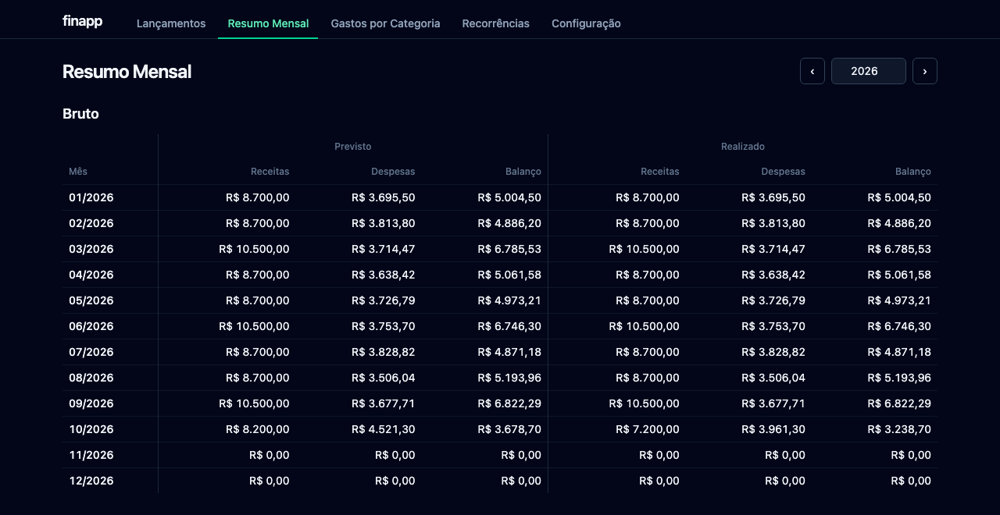
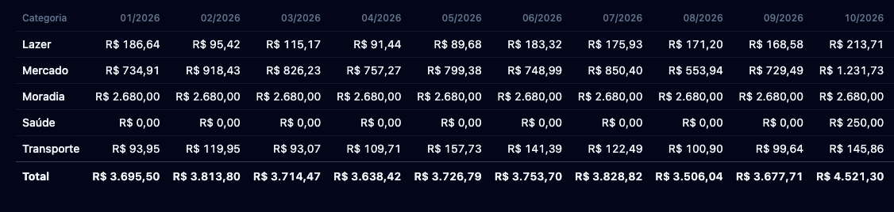

# finapp

A local-first personal finance app that replaces a spreadsheet. A single binary
(Go + SQLite + embedded React app): run it and it opens in your browser. Your data
stays in one SQLite file on your machine.

## Screenshots

Sample data, default pt-BR interface (English is available in the settings).





## Running

Run `./finapp`: it starts a local server and opens your browser. Closing the terminal stops it.

- The database is `finapp.db` next to the executable. Override it with `--db <path>` or `FINAPP_DB`; the flag wins.
- The default address is `127.0.0.1:8080`. If another finapp is already there, only the browser opens; if something else is, a free port is used. `--addr` fixes the address.
- `--no-browser` skips opening the browser.

### Install

Download the archive for your platform from the [releases page](../../releases), extract it and run `finapp`.

On macOS, Gatekeeper blocks binaries downloaded from the internet. Remove the quarantine flag once:

```sh
xattr -d com.apple.quarantine ./finapp
```

Double-clicking the binary on macOS opens it in Terminal; closing that window stops the app.

## Importing data

There is no import feature in the app. Start finapp once so it creates the database, stop it, then load your data with
`sqlite3 <path to finapp.db> < import.sql` (the file next to the executable, or the path you gave with `--db`). Tables, columns and rules are documented in [docs/schema.md](docs/schema.md).

## Architecture

Go (`net/http`) serves a JSON API and the React app embedded with `go:embed`; data lives in SQLite through a pure-Go
driver, so there is no CGO and the binary is portable. Business rules sit in `internal/domain` and have no I/O. See
[CONTRIBUTING.md](CONTRIBUTING.md) for the layout.

## Development

Requirements: Go 1.26+ and Node 22+.

```sh
make dev     # API on :8080 (database ./dev.db) and Vite dev server with /api proxy
make test    # Go and web tests
make lint
make build   # produces ./finapp with the web app embedded
```

## Contributing

See [CONTRIBUTING.md](CONTRIBUTING.md).

## License

[MIT](LICENSE)
